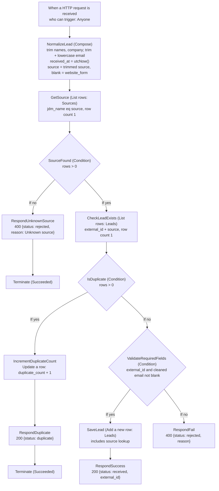

# Rivertown Lead Intake - Power Automate rebuild (v1)

The first half of the n8n Lead Intake build (receive, clean, check, save, reply), rebuilt in Microsoft Power Automate and Dataverse for the master calendar's Week 6 cross-platform comparison. Built and tested 2026-09-30 in a Power Apps Developer Plan environment. All data is synthetic; Rivertown Professional Services is fictional.

Added 2026-10-17: source lookup (unknown source = 400, missing = website_form) and duplicate handling (a resend bumps duplicate_count; no second row).

Not included yet (later blocks): AI triage, routing, audit trail (WorkflowRun), approvals, Try/Catch.

## Files

| File | Contents |
|---|---|
| `RivertownLeadIntake_1_0_0_2.zip` | Unmanaged solution export (2026-10-17): Lead and Source tables with their keys, the flow with source lookup and duplicate handling, the Dataverse connection reference. Scanned before commit: no flow address, no signature, no account names. Source rows are data and are not in the export (see runbook). v1.0.0.1 (2026-09-30) is in git history. |

## The flow

In Power Automate, steps are stacked and a run continues past a Condition to the next card, so each special branch ends with Terminate. Decisions: decisions.md, 2026-10-17.

Same contract as the n8n build: only external_id and email are required (decision D4), and cleaning happens before the check (D5).

## n8n to Power Automate terms

| n8n | Power Automate | Note |
|---|---|---|
| Workflow | Cloud flow | |
| Node | Action (the first one is the trigger) | |
| Webhook node | When a HTTP request is received | Premium |
| Header Auth credential (API key in a header) | "Who can trigger: Anyone": a signed web address (`sig=`) is the key | Tenant options require an OAuth token from the organization |
| Credential | Connection (the stored key) and connection reference (the label inside a solution) | The reference travels in the export; each environment plugs in its own connection |
| Edit Fields (Set) | Compose | |
| IF | Condition (If yes / If no) | |
| Respond to Webhook | Response | Premium |
| Data Table Get (CheckLeadExists) | List rows (Dataverse) | Always returns a list (`body/value`); found = `length(...) > 0` |
| Data Table Insert | Add a new row | |
| Data Table Update (IncrementDuplicateCount) | Update a row | Needs the row ID; read first, then write (Upsert cannot add 1) |
| A branch that just ends | Terminate | n8n stops at a dead end; Power Automate continues to the next card unless told to stop |
| Data Table | Dataverse table | Dataverse enforces column types, lengths, and dependencies |
| Expression `{{ }}`, `$json.body.x` | Expression (fx tag), `triggerBody()?['x']` | Typed text is literal; only an fx tag is evaluated |
| `$('Node').item.json.x` | `outputs('Node')?['x']` | Needed when the step is not the previous one |
| `?.` and `?? ''` | `?[...]` and `coalesce(x, '')` | Missing field gives empty, not an error |
| Executions list | 28-day run history | Duration alone showed which path ran |
| Execution ID | Run's client tracking ID | Power Automate stamps it on every run |
| Publish / unpublish | Save turns the flow on; Turn off / Turn on | |
| Workflow JSON export | Solution export (zip), unmanaged | |

## Lead table field map

| Column (display) | Technical name | Type | Value comes from |
|---|---|---|---|
| external_id (primary column) | jdm_externalid | Text, max 100, Business required (2026-10-16; was 850, Optional) | Form, as received |
| source | jdm_source | Lookup to Source, Business required (2026-10-16) | The form's `source` name (missing = website_form), looked up in Source by GetSource; SaveLead writes `jdm_sources(<row ID>)` |
| first_name | jdm_firstname | Text | NormalizeLead (trimmed) |
| last_name | jdm_lastname | Text | NormalizeLead (trimmed) |
| email | jdm_emailaddress | Email | NormalizeLead (trimmed, lowercase) |
| company | jdm_companyname | Text | NormalizeLead (trimmed) |
| phone | jdm_phonenumber | Phone | Form, as received |
| engagement_type | jdm_engagementtype | Text | Form, as received |
| company_size | jdm_company_size | Text | Form, as received |
| message | jdm_inquirymessage | Text, max 4,000 | Form, as received |
| submitted_at | jdm_submissiontimestamp | Date and time | Form, as received |
| received_at | jdm_receivedtimestamp | Date and time | NormalizeLead (utcNow) |
| status | jdm_inquirystatus | Choice | Not written yet |
| routed_to | jdm_routeddepartment | Choice | Not written yet |
| duplicate_count | jdm_duplicatecount | Whole number | Empty on a new row; IncrementDuplicateCount adds 1 on each resend (2026-10-17) |

Rule used for column types: input from outside (the website form) is stored as text, exactly as received; dropdowns (Choice) only for values Rivertown controls. A Choice column rejects any value not on its list, which would lose the lead.

The technical names were chosen by the import's AI and differ from the display names. Dataverse adds its own system columns (owner, created on, and others).

## Source table and keys (added 2026-10-16)

The SQLite blueprint (../sqlite/schema.sql) rebuilt in Dataverse, part 1. Decisions: decisions.md, 2026-10-16.

| SQLite | Dataverse |
|---|---|
| `Source (source_id INTEGER PRIMARY KEY, name TEXT NOT NULL UNIQUE)` | Table **Source** (jdm_source). Row ID column **Source** (jdm_SourceId, a long code instead of 1, 2). Primary column **name** (jdm_name). Key **Unique source name** (jdm_uniquesourcename) on name. Rows: website_form, event_form |
| `Lead.source_id INTEGER NOT NULL REFERENCES Source (source_id)` | Lead column **source** (jdm_source), Lookup to Source, Business required |
| `UNIQUE (external_id, source_id)` | Lead key **Unique lead per source** (jdm_uniqueleadpersource) on external_id + source. Active |
| `lead_id INTEGER PRIMARY KEY` | Lead row ID column **Lead** (jdm_LeadId), Unique identifier |
| `NOT NULL` | Closest: Business required, which Microsoft's screens and the flow designer (Add a new row) enforce, but the API does not |

Not yet in Dataverse: Company (company stays as text on Lead), WorkflowRun, ReviewDecision.

## Tests

Pass/fail rules were written before the runs.
- 2026-09-30, T1-T3 (save, missing field, cleaning): all passed. test-cases.md, "2026-09-30 - Power Automate rebuild".
- 2026-10-17, T4-T7 (new, resend, unknown source, missing source): all passed; T4 needed a second run after a filter fix. test-cases.md, "2026-10-17". Closes the Gate 1 #7 UPDATE note.

## Running it

- The flow's web address is the password. It is kept outside the repo; never paste it into chat, screenshots, or the repo.
- Send with the Postman desktop app: POST, Body raw JSON, header Content-Type application/json.
- Importing this solution elsewhere generates a new web address and asks for a Dataverse connection for the connection reference.
- Licensing: the HTTP trigger, Response, and Dataverse are Premium. Free in the Developer Plan; a paid license cost for a real client.
